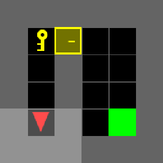

# MiniGrid DoorKey: Behavior Cloning + HG-DAgger

Imitation learning on MiniGrid `DoorKey-6x6`: the agent has to pick up the key, open the door and reach the green square.

1. Demonstrations are recorded by hand with a small Tkinter UI.
2. A small CNN policy is trained with behavior cloning (cross-entropy on the demo actions).
3. The trained policy plays by itself; when it gets stuck I take over and record corrections (human-gated DAgger).
4. The policy is retrained from scratch on demos + corrections.

## Demo



## Results

Both policies were evaluated on the same 200 fixed layouts (seeds 1000-1199):

| Training data | argmax | sampling |
|---|---|---|
| demos only (2373 samples) | 0.965 | 1.000 |
| demos + corrections (2373 + 149 samples) | 0.995 | 1.000 |

200 episodes is a small sample, so the gain is a good sign rather than proof.

## Files

- `collect_demos.py`: UI for recording demonstrations into `demos.npz` (new episodes are appended to the existing file)
- `collect_corrections.py`: loads `policy.pt`, lets the policy play, and records only my actions after pressing Take Over into `corrections.npz`
- `train.py`: trains from scratch on `demos.npz` (plus `corrections.npz` if it exists), saves `policy.pt`, then evaluates it
- `demos.npz`, `corrections.npz`, `policy.pt`: the collected data and the trained model

## Setup

```
pip install numpy gymnasium minigrid pillow torch
```

Tkinter is also required (on Ubuntu: `sudo apt install python3-tk`).

## Usage

```
python collect_demos.py         # record demos (Save or Discard each episode)
python train.py                 # train + evaluate
python collect_corrections.py   # DAgger round: fix the policy's mistakes
python train.py                 # retrain with the corrections included
```
